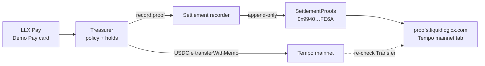

# Judges guide — Liquid Logic X (Tempo track)

**Product:** LLX Pay + Settlement Proofs — non-custodial USDC payments with human approval gates and independently checkable on-chain receipts.

**Company:** Liquid Logic X LLC (Active, California) · https://liquidlogicx.com

This page is the shortest path for Colosseum / Tempo-track judges to understand the product and verify live mainnet receipts yourself.

## What runs on Tempo mainnet today

| Piece | Detail |
| --- | --- |
| Payments | USDC.e via TIP-20 `transferWithMemo` on Tempo mainnet (chain `4217`) |
| SettlementProofs registry | [`0x9940a8fE88f8BE0bB8E05686631Fd638DC1DfE6A`](https://explore.tempo.xyz/address/0x9940a8fE88f8BE0bB8E05686631Fd638DC1DfE6A) |
| Recorder | Verifies the payment on-chain, then appends a permanent proof to the registry |
| Public verifier | https://proofs.liquidlogicx.com/?network=tempo-mainnet |
| Demo Pay (LLX Pay) | https://llx-pay.vercel.app — treasurer-backed Demo Pay on Tempo |
| Policy (code-enforced) | Max **5** USDC.e per payment · **25** USDC.e / day · payee allowlist · hold-for-approval at/above **2.00** · human must Approve before the transfer fires |

## Architecture



ASCII equivalent:

```
LLX Pay  →  treasurer  →  Tempo (USDC.e transferWithMemo)
                │                    │
                └→ recorder  →  registry 0x9940…FE6A
                                      │
                                      └→ proofs.liquidlogicx.com
                                         (re-checks payment on Tempo RPC)
```

## Live mainnet loops (Oct 10, 2026 ~7:48–8:23 PM PT)

### 1. 1.00 USDC.e — direct Demo Pay (~7:48 PM PT)

| | Link |
| --- | --- |
| Payment | https://explore.tempo.xyz/tx/0xc358469f136a5d08a2ea93d85482b262a3dec05e619ff5350027024b8c5a83c9 |
| Proof | https://explore.tempo.xyz/tx/0xebbe3c22781cc04383def003de0daeed4c6d348d7c3275b8aeedc1d2c2cfbc82 |
| Verify | https://proofs.liquidlogicx.com/proofs/0xbdb798969fea8b19cd62facd58edba766b4639e430cb3fc37d8e96a1199a90a3?network=tempo-mainnet |

### 2. 3.00 USDC.e — held → human approved → paid + proven (~7:50 PM PT)

| | Link |
| --- | --- |
| Payment | https://explore.tempo.xyz/tx/0xe85e0c40433d2274c0d0349872f685557fa36f1aacbafd938e9030b1a8a1a140 |
| Proof | https://explore.tempo.xyz/tx/0x7e6fcb2ec4461782ae2b2dd60ed8c8d8c05f2b6610e72a521a83fe02f9c58d9f |
| Verify | https://proofs.liquidlogicx.com/proofs/0xc9d5bda81c4dfd33a740e311e3cae8439f1f8feaba676b34f0b0e6f966c13ce4?network=tempo-mainnet |

The 3.00 path is the approval gate in action: at/above 2.00 USDC.e the treasurer holds; a human Approves; only then does the USDC.e transfer and proof record land on Tempo.

### 3. Agent-initiated 3.00 USDC.e — held → approved on phone → paid + proven (~8:23 PM PT) — **the run on the demo video**

An AI agent requested the payment (memo `Agent-initiated: LLX crew`); the treasurer held it at/above 2.00; the owner tapped Approve on their phone; then the USDC.e transfer and the proof landed on Tempo.

| | Link |
| --- | --- |
| Payment | https://explore.tempo.xyz/tx/0x4725652d280b032aab032ee7275abb8c03ae938470b2c225261a5d1a96def55a |
| Proof | https://explore.tempo.xyz/tx/0xfc12c88494a3f67ec12115067e7a978e6520ba4a97c5e6894fc260c2948a1027 |
| Verify | https://proofs.liquidlogicx.com/proofs/0x9bf27eb620b30f1cae543640f184ecf68ac1093892104dbe2d691343a127992a?network=tempo-mainnet |

## How to verify a receipt yourself (2 minutes)

1. Open **https://proofs.liquidlogicx.com/?network=tempo-mainnet**
2. Open any verify link above (or paste the **payment** tx hash into the verifier).
3. Confirm payer → payee, amount (USDC.e), and the green on-chain re-check badge.
4. Open the payment tx on [explore.tempo.xyz](https://explore.tempo.xyz) and compare amount / parties / memo to the proof page.
5. Open the proof tx on the explorer — it writes to registry `0x9940…FE6A` and is append-only (no edit/delete).

You do not need an account or wallet to check a proof.

## Ecosystem

- **AI on Base 48H Recap (Oct 9, 2026):** @LiquidLogicX listed in the x402 box — https://x.com/AIonBase_/status/2108632892155081089 · LLX note https://x.com/LiquidLogicX/status/2108694081430049002
- **OpenSea Tools x402 Bazaar (live):** [audit](https://opensea.io/tools/x402-bazaar/base/3317393016839325995) · [allowance](https://opensea.io/tools/x402-bazaar/base/7488019161331629522)

## Links

| What | URL |
| --- | --- |
| Pay demo | https://llx-pay.vercel.app |
| Proofs (Tempo mainnet) | https://proofs.liquidlogicx.com/?network=tempo-mainnet |
| Site | https://liquidlogicx.com |
| This repo (public) | https://github.com/LiquidLogicX/settlement-proofs-arc |
| Hackathon pack | [`hackathon/`](hackathon/) |

---

*Liquid Logic X LLC · Active, California*
